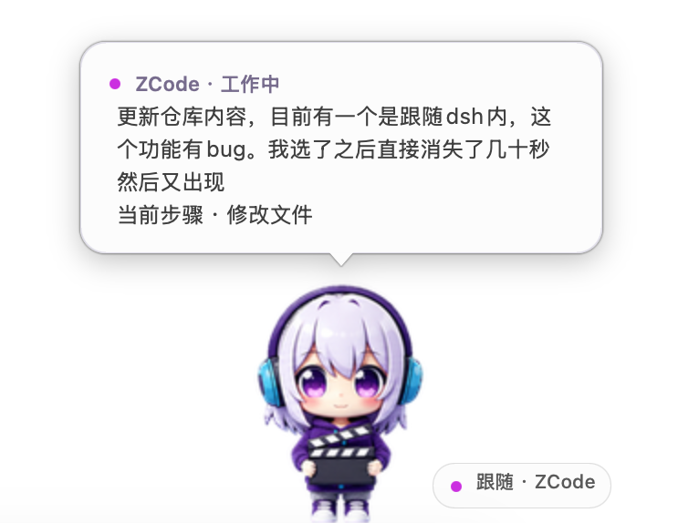

# Iven Pet 🐾

简体中文 | [English](README.en.md)

[](https://github.com/IvenKooLab/desktop-pet/releases/latest)


一只陪你工作、偶尔摸鱼的 3D 绒质桌宠。紫白短发、青蓝耳机、随身场记板——Iven 会在桌面上小跳漫游，挥手、打板、观察四周，也会在你点击和拖动时作出反应。

独立运行，无需 Codex、账号或模型 API。

[下载最新版本](https://github.com/IvenKooLab/desktop-pet/releases/latest) · [更新日志](CHANGELOG.md)

## 看看她的日常

| 眨眼与四处看看 | 挥手、弹跳、打板 | 等待、工作、检查 |
| :---: | :---: | :---: |
|  |  |  |

### 摸鱼时间

伸个懒腰、眯一会儿，再认真转几下魔方。三种小动作也会出现在自动轮播中，右键菜单可以单独点播。


## 快速开始

**下载打包版（推荐）**：从[发布页](https://github.com/IvenKooLab/desktop-pet/releases/latest)下载对应平台的 zip，解压即用——

- **macOS 13+**：打开 `IvenPet.app`。Mac 包为临时签名、未做公证，若提示"无法验证开发者"，右键 App 选"打开"，或执行 `xattr -d com.apple.quarantine IvenPet.app` 后再打开。
- **Windows**：运行 `IvenPet.exe`，无需安装 Python。

**从源码运行**（体验最新动作）：

```bash
# macOS：双击 start-mac.command，或
zsh tools/build_macos.sh   # 首次构建需要 Apple 命令行工具（xcode-select --install）
open build/IvenPet.app

# Windows：Python 3.8+（自带 tkinter）
python pet.py
```

## 会做什么

- **桌面漫游**：八帧小跳移动、加速移动；Windows 下还会沿任务栏和可见窗口顶边行走，走到边缘掉头或掉落，支撑的窗口关闭或移走时随之下落。
- **开场与台词**：从天而降、落地、挥手亮相；Windows 下有随机台词气泡。
- **表情与动作**：六帧眨眼待机、挥手、五帧弹跳、开心、害羞、打板、十六方向观察四周、闭眼睡觉，工作、等待、检查、失落，以及伸懒腰、打瞌睡和玩魔方。
- **自动表演**：默认轮播较长的完整动作段，动作之间稍作休息；生活动作约持续 11–21 秒，保留 75% 播放速度，右键可暂停或点播。
- **工作陪伴主题**：苦思冥想、等待不耐烦、额度不足、松口气。四组演出由已确认的原版帧组合，保持造型与配色；工作与思考交替，等待确认超过 30 秒后切换等待主题，明确完成事件触发松口气。额度不足仅供手动点播，不代表检测到了真实余额。
- **鼠标互动**：单击弹跳，双击开心，拖拽时有抓取反应，松手后重力下落并落地。
- **甩抛物理**：快速甩出会抛物线飞行——屏幕左右/顶部边缘反弹，落地按剩余能量弹跳、逐次衰减直到停稳；温柔放下则原地落定。Mac 端落地瞬间有 Q 弹挤压动画，两端物理语义一致。
- **流畅透明**：约 60fps 渲染，统一角色比例和动作时间轴；Mac 使用原生透明窗口。
- **位置记忆与系统通知**：重启后回到上次离开的位置（`~/.iven-pet/config.json`）；任务完成、出问题、等待确认时可弹原生系统通知——默认只在桌宠隐藏（DSH 界面内）时打扰，可改为总是/关闭。
- **脚本可驱动**：本机文件控制接口（[docs/API.md](docs/API.md)）让其他插件或命令行让 Iven 说话、点播动作、读实况：`python tools/iven_cli.py say "休息一下"`。零网络零端口。

## 两种显示模式

- **独立桌面**：macOS 原生窗口 / Windows 桌宠，脱离编码助手也能运行。
- **DSH 界面内**：安装 [DSH 适配器](adapters/dsh/README.md) 后，在 DSH 的 Iven 入口将角色移入界面；支持拖拽、动作点播和状态气泡。独立桌宠的"显示模式"菜单也可发起切换。

切换会协调两端显示，避免同时出现两个 Iven。只有 DSH 网页确认接手显示后桌宠才会隐藏；无人接手约 6 秒自动退回桌面并提示，DSH 页面关闭或失联后最长约 30 秒恢复桌面显示。首次启用前端插件需要重新加载 DSH；此模式目前只适用于 DSH，其他 Harness 仍通过适配器联动独立桌宠。

## 工作时，她也在身边

Iven 首先是一只独立桌宠，也可以通过可选适配器跟随本地编码助手。接入后，工作时显示状态卡，等待权限确认时保留提醒，本轮结束或失败时给出反馈。开启摘要后，还可显示适配器提供的任务标签或回复摘要；可显示的内容取决于来源，不是所有助手都提供完整上下文。



### 选择跟踪来源

右键 → **跟踪 Harness**：

- **自动 · 全部已接入**：接收所有已配置来源的事件，优先显示等待确认的会话，其次最近活跃的会话。
- **指定一个来源**：只显示该来源的状态与提醒，其他助手不会抢占显示。
- **查看各来源状态**：工作中、等你确认、空闲或未收到事件。打开助手应用、或在菜单中选择它，都不代表已经接通；需要先安装对应适配器。

跟随徽章显示当前跟随的助手；自动模式下的 `+1` 表示还有一个活跃来源。指定来源尚无事件时，显示"Codex · 未收到事件"等提示。一个桌宠同时接收多个来源，状态卡一次展示一个会话。

### 哪些助手可以接入

| 来源 | 接入方式 | 当前范围 |
| :--- | :--- | :--- |
| [ZCode](adapters/zcode/README.md) | Hooks | 工作、工具活动、等待确认与本轮结束；可选任务标签与回复摘要 |
| [DSH / DeepSeek Harness](adapters/dsh/README.md) | 宿主插件 | 会话和工具事件、等待确认、目标结果；可选任务标签 |
| [Claude Code](adapters/claude-code/README.md) | Hooks | 已提供适配器及事件重放测试，仍需在实际客户端验证 |
| [Cursor](adapters/cursor/README.md) | Hooks | 已提供适配器及事件重放测试，仍需在实际客户端验证 |
| [OpenCode](adapters/opencode/README.md) | Server 事件流 | 已提供状态适配器及模拟服务测试，仍需在实际客户端验证 |
| [Codex](adapters/codex/README.md) | 独立 App Server 客户端 | **当前无法跟随你正在使用的 Codex 桌面会话**。仅完成独立客户端握手、线程列表读取与模拟事件验证；不是开箱即用的桌面接入 |

各适配器需要单独安装，详见表中的链接与[能力矩阵](adapters/README.md)。本项目不包含 ChatGPT / Codex 内置宠物，也不依赖它们运行。

### 本地通信与内容开关

适配器通过本机文件收件箱向桌宠发送事件，全程无网络、无需额外模型调用。默认只发送状态和工具名称；任务标签与回复摘要需单独开启，并会截断——开启后这些文本才会写入本地事件文件、显示在桌面上。桌宠不自动批准权限、不发送任务，也不接管助手；关闭任意一端，另一端照常工作。

协议与开发说明见 [docs/BRIDGE.md](docs/BRIDGE.md)。

### 和 Iven 说话

右键菜单 → **"和 Iven 说话…"**，输入一句话，Iven 会用你 DSH 里配置的模型
生成回复：气泡显示，偶尔搭配一个表情动作，本地保留最近 8 轮记忆
（清空即删 `~/.iven-pet/chat/memory.json`）。需要 DSH 在线且装好适配器；
没接通时她会如实告诉你，而不是假装聊天。对话同样只在本机进行，
桌宠本体保持零模型依赖。

## 怎么互动

| 操作 | 效果 |
| :--- | :--- |
| 单击 | 弹跳；睡觉时唤醒 |
| 双击 | 开心反应 |
| 按住拖动 | 移动桌宠，松手后自然下落 |
| 按住甩出 | 抛物线飞行，屏幕边缘反弹、落地弹跳 |
| 右键 | 和 Iven 说话、点播动作、切换自动轮播、系统通知、选择跟踪来源、睡觉、退出 |
| Control + 点击（Mac） | 打开菜单 |
| 固定在当前位置（Mac） | 停止漫游，保留原地动画 |

右键菜单里还可以切换界面语言（跟随系统 / 简体中文 / English，立即生效并记住选择）、打开 GitHub 仓库。

手动选择睡觉后会保持睡眠，点击即可唤醒。Mac 沿桌面底边漫游；其他应用窗口顶边行走和随机台词气泡目前仅 Windows 支持；Mac 支持编码助手状态气泡。Linux 暂未支持。

## 从源码构建

打包发布版（对应 release 里的安装包）：

```bash
# Windows：先安装 PyInstaller
pip install pyinstaller
tools\build_exe.bat

# macOS
zsh tools/build_macos.sh
```

运行时无需第三方 Python 包。素材导出、GIF 生成和验证方法见[维护说明](docs/IVEN_V2_MIGRATION.md)。

## 致谢

感谢 [dsh-pet](https://github.com/PC2005-cloud/dsh-pet) 提供的动作编排和日常小动作灵感。

## License

[MIT](LICENSE) · Iven 角色素材由 AI 生成，归 IvenKooLab 所有。
