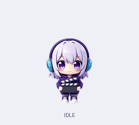
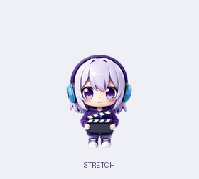

# Iven Pet 🐾

简体中文 | [English](README.en.md)

一只陪你工作、偶尔摸鱼的 3D 绒质桌宠。紫白短发、青蓝耳机、随身场记板——Iven 会在桌面上小跳漫游，挥手、打板、观察四周，也会在你点击和拖动时作出反应。

支持 **macOS / Windows**，独立运行，无需 Codex、账号或模型 API。

## 看看她的日常

| 眨眼与四处看看 | 挥手、弹跳、打板 | 等待、工作、检查 |
| :---: | :---: | :---: |
|  |  |  |

### 摸鱼时间

伸个懒腰、眯一会儿，再认真转几下魔方。三种小动作也会出现在自动轮播中，右键菜单可以单独点播。



## 会做什么

- **桌面漫游**：八帧小跳移动、加速移动；Windows 掉头时有正面停顿。
- **表情与动作**：六帧眨眼待机、挥手、五帧弹跳、开心、害羞、打板、等待、工作、检查、失落、十六方向观察四周、闭眼睡觉，以及伸懒腰、打瞌睡和玩魔方。
- **自动表演**：默认自动轮播，动作之间稍作休息；每轮打乱顺序，右键可随时暂停或点播。
- **鼠标互动**：单击弹跳，双击开心，拖拽时有抓取反应，松手后重力下落并落地。
- **流畅透明**：约 60fps 渲染，统一角色比例和动作时间轴；Mac 使用原生透明窗口。
- **Windows 窗口即平台**：沿桌面、任务栏和可见窗口顶边行走，走到边缘会掉头或落下；窗口关闭或移走时随之下落。开场从天而降、落地、挥手，并有随机台词气泡。
- **Mac 固定位置**：可以留在你选的位置，继续播放原地动作。

## 快速开始

### macOS

双击仓库中的 **`start-mac.command`**。首次运行会构建应用，需要 Apple 命令行工具：

```bash
xcode-select --install
```

之后也可直接打开 `build/IvenPet.app`，无需 Python。

### Windows

安装 Python 3.8+（包含 tkinter），在项目目录运行：

```bash
python pet.py
```

[发布页](https://github.com/IvenKooLab/desktop-pet/releases)也提供已打包版本。体验最新动作请从当前源码运行或重新构建。

## 工作时，她也在身边

Iven 首先是一只独立桌宠，也可以通过可选适配器跟随本地编码助手。接入后，工作时显示状态卡，等待权限确认时保留提醒，本轮结束或失败时给出反馈。开启摘要后，还可显示适配器提供的任务标签或回复摘要；可显示的内容取决于来源，不是所有助手都提供完整上下文。

### 选择跟踪来源

右键 → **跟踪 Harness**：

- **自动 · 全部已接入**：接收所有已配置来源的事件，优先显示等待确认的会话，其次最近活跃的会话。
- **指定一个来源**：只显示该来源的状态与提醒，其他助手不会抢占显示。
- **查看各来源状态**：工作中、等你确认、空闲或未收到事件。打开助手应用、或在菜单中选择它，都不代表已经接通；需要先安装对应适配器。

身旁的小标识显示当前跟随的助手；自动模式下的 `+1` 表示还有一个活跃来源。指定来源尚无事件时，显示“Codex · 未收到事件”等提示。一个桌宠同时接收多个来源，状态卡一次展示一个会话。

### 哪些助手可以接入

| 来源 | 接入方式 | 当前范围 |
| :--- | :--- | :--- |
| [ZCode](adapters/zcode/README.md) | Hooks | 工作、工具活动、等待确认与本轮结束；可选任务标签与回复摘要 |
| [DSH / DeepSeek Harness](adapters/dsh/README.md) | 宿主插件 | 会话和工具事件、等待确认、目标结果；可选任务标签 |
| [Claude Code](adapters/claude-code/README.md) | Hooks | 已提供适配器及事件重放测试，仍需在实际客户端验证 |
| [Cursor](adapters/cursor/README.md) | Hooks | 已提供适配器及事件重放测试，仍需在实际客户端验证 |
| [OpenCode](adapters/opencode/README.md) | Server 事件流 | 已提供状态适配器及模拟服务测试，仍需在实际客户端验证 |
| [Codex](adapters/codex/README.md) | 独立 App Server 客户端 | **当前无法跟随你正在使用的 Codex 桌面会话**。仅完成独立客户端握手、线程列表读取与模拟事件验证；不是开箱即用的桌面接入 |

各适配器需要单独安装，详见表中的链接与[能力矩阵](adapters/README.md)。本项目不包含 ChatGPT / Codex 内置宠物，也不依赖它们运行。

### 本地通信与内容开关

适配器通过本机文件收件箱向桌宠发送事件，桌宠无需额外模型调用。默认发送状态和工具名称；任务标签与回复摘要需单独开启，并会截断。开启后这些文本也会写入本地事件文件、显示在桌面上。桌宠不自动批准权限、不发送任务，也不接管助手；关闭任意一端不影响另一端正常使用。

协议与开发说明见 [docs/BRIDGE.md](docs/BRIDGE.md)。

## 怎么互动

| 操作 | 效果 |
| :--- | :--- |
| 单击 | 弹跳；睡觉时唤醒 |
| 双击 | 开心反应 |
| 按住拖动 | 移动桌宠，松手后自然下落 |
| 右键 | 点播动作、切换自动轮播、选择跟踪来源、睡觉、退出 |
| Control + 点击（Mac） | 打开菜单 |
| 语言 / Language | 跟随系统、简体中文、English；立即生效并记住选择 |
| 打开 GitHub 仓库 | 用默认浏览器打开项目主页 |
| 固定在当前位置（Mac） | 停止漫游，保留原地动画 |

手动选择睡觉后会保持睡眠，点击即可唤醒。Mac 沿桌面底边漫游；其他应用窗口顶边行走和随机台词气泡目前仅 Windows 支持；Mac 支持编码助手状态气泡。Linux 暂未支持。

## 从源码构建

```bash
# Windows：先安装 PyInstaller
pip install pyinstaller
tools\build_exe.bat

# macOS
zsh tools/build_macos.sh
```

运行时无需第三方 Python 包。素材导出、GIF 生成和验证方法见[维护说明](docs/IVEN_V2_MIGRATION.md)。

## 致谢

感谢 [dsh-pet](https://github.com/PC2005-cloud/dsh-pet) 提供的动作编排和日常小动作灵感。

## License

[MIT](LICENSE) · Iven 角色素材由 AI 生成，归 IvenKooLab 所有。
