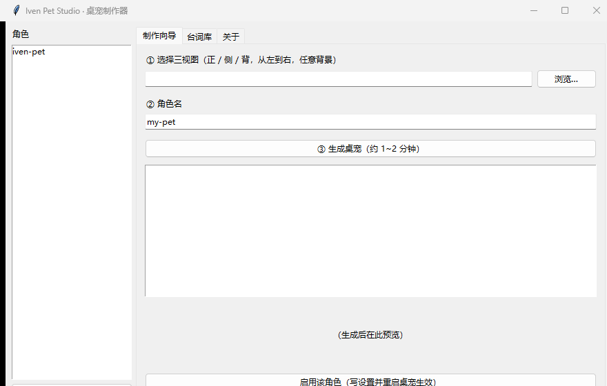

# desktop-pet · Iven Pet 3D 🐾

**2026-10-13 默认角色已更新为 Iven v2**：保留原版 3D 绒质手办风格，统一比例和脚底位置，清理洋红残边，使用完整动作时间轴。内置与 Studio 角色同步更新。详情和回退方式见 [更新说明](docs/IVEN_V2_MIGRATION.md)。

独立的 macOS / Windows 桌宠：原版 3D 绒质场记板少女，不需要 Codex、账号或模型 API。

**想给任意 IP 角色做同款桌宠？看 [docs/SOP-IP角色桌宠化.md](docs/SOP-IP角色桌宠化.md)**——从设定图生成、AI 抠图、动作帧合成、三重自检到 PyInstaller 打包的完整标准作业流程（含踩坑速查表）。

**运行时零第三方依赖**——Mac 使用原生 AppKit，Windows 使用 Python 标准库 tkinter。发布素材由 `tools/export_iven_v2.py` 从已确认母版导出。


## 动态预览

| 待机与观察 | 挥手、弹跳、打板 | 自动动作串联 |
| :---: | :---: | :---: |
|  |  |  |

GIF 由发布 PNG 与逐帧时间轴生成，背景仅用于展示透明边缘；不是桌面录屏。第三组展示等待、工作、检查、失落与待机的串联，实际自动播放顺序随机。

默认开启自动轮播：动作池每轮打乱，用完后重新洗牌，穿插 3–6 秒待机。右键“自动轮播动作”可暂停；手动睡觉保持睡眠，点击唤醒。Mac 固定位置时只播放原地动作，拖拽时暂停调度。现有九种源动画与十六方向视线全部沿用已确认的 Iven v2 比例。

动作链与动态展示思路参考 [dsh-pet](https://github.com/PC2005-cloud/dsh-pet)，角色素材使用本项目自己的 Iven v2。

重新生成预览：`python tools/make_readme_previews.py`（仅生成时需要 Pillow）。

## 功能

- **原版 3D 绒质动作库**：六帧眨眼待机 / 八帧小跳移动（掉头有正面过渡）/ 加速移动 / 五帧点击弹跳 / 双击开心反应 / 害羞反应 / 打板 🎬 / 十六方向观察四周 👀 / 闭眼睡觉 / 抓取反应 / 重力下落与落地。所有动作共享尺寸基准和逐帧时间轴。
- **~60fps 渲染**：逻辑固定 50ms 步长 + 墙钟动画相位 + 窗口位置亚像素插值（告别 20fps 阶梯感）
- **Windows 窗口即平台（Shimeji 式）**：屏幕底部 + 任务栏顶边 + 所有可见窗口的顶边都是路——掉落时踩到就落地，沿边缘行走，走到边缘多半掉头、偶尔走空掉下去；窗口关闭或移走，她也会跟着掉下来
- **Windows 开场演出**：从天上掉下来 → 落地弹压 → 挥手「我上线啦！」
- 右键菜单、左键拖拽到任意位置；随机台词气泡目前仅 Windows

## 使用

```bash
python pet.py
```

Windows：Python 3.8+（tkinter）。Mac：双击根目录 **start-mac.command**；首次构建需安装 Apple 命令行工具（`xcode-select --install`）。生成的 `build/IvenPet.app` 可独立运行，无需 Python。独立程序不需要 Codex、账号或模型 API。

Mac 使用原生透明窗口与 PNG alpha，Windows 使用色键 GIF。拖拽、点击、双击和菜单两端共用；Mac 还支持 Control＋点击菜单。目前其他应用窗口顶边的平台行走仅在 Windows 实现，Mac 沿桌面底边移动，Linux 尚未适配。




## MVP：只传一张三视图

不想凑齐全套 Sheet？一张三视图（正/侧/背，从左到右）即可出**简化版**桌宠（呼吸压扁 + 程序剪腿步态 + 转体，21 帧）：

```bash
python tools/make_pet_from_views.py --src 路径/三视图.png --out frames3d_mvp
set PET_FRAMES_DIR=frames3d_mvp
python pet.py
```

## 重新生成完整素材帧（可选，仓库已带成品帧）

```bash
python tools/make_frames3d.py           # 抠图+切片，产出 assets/cut/preview.png 供人工检查
python tools/export_iven_v2.py          # 从批准的 v2 母版生成默认角色和 Studio 帧
python tools/make_frames3d.py --frames --legacy  # 旧管线仅输出隔离的 frames3d_legacy/
python tools/qa_frames.py               # 数值自检：碎片/孔洞/尺寸一致性
python tools/qa_diff.py                 # 像素回归：成品帧 vs 源切图逐帧对比
python tools/smoke.py                   # 状态机冒烟测试，自动触发各状态并截图
```

素材源在 `assets/src/`（豆包 AI 生成）：`views_clean.png` 正/侧/背三视图、`walk_cycle.png` 走路循环、`fastwalk.png` 小短腿快走、`idle_breathe.png` 待机呼吸、`actions_lib.png` 八宫格动作库、`wr_*_single.png` 右向单人物原图、`views_blueprint.png` 标注版留档。

抠图管线：新版素材走 **rembg AI 抠图**（滞后阈值 + 深色部件回收 + fill_holes 三层保险，见 `tools/make_frames3d.py` 的 `rembg_fg`）；老版青蓝渐变底用「G-R/B-G 颜色闸门 + 相邻像素局部梯度洪泛」双条件（`flood_bg`）。

## License

MIT
